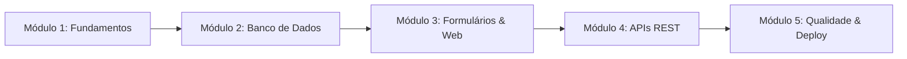

# Trilha de Aprendizado PHP com IA (Do Zero ao Profissional)

Uma jornada progressiva em 5 módulos para quem está começando. Siga esta ordem ao pedir para a IA te ensinar e construir sistemas.

---

## 🗺️ Visão Geral da Trilha

---

## Módulo 1: Fundamentos da Linguagem e Tipos Estritos
**Objetivo:** Entender como o PHP moderno funciona sem os vícios antigos da internet.

- **O que você vai aprender:** Variáveis, tipos (`int`, `float`, `string`, `bool`, `array`), operadores, estruturas de decisão (`match` e `if/else`) e funções tipadas.
- **Prompt para pedir à IA:**
  > *"Atue como mentor da skill `php-doc-pt-br`. Estou no Módulo 1 da Trilha. Crie um script demonstrativo de uma calculadora financeira simples usando `declare(strict_types=1);`, funções com tipos estritos e a expressão `match`. Explique linha por linha com analogias simples."*
- **Referência para estudar:** [padroes-de-desenvolvimento.md](../references/padroes-de-desenvolvimento.md)

---

## Módulo 2: Banco de Dados com PDO (Zero SQL Injection)
**Objetivo:** Conectar seu sistema a um banco relacional (MySQL/PostgreSQL/SQLite) de forma profissional.

- **O que você vai aprender:** Instanciar PDO, configurar tratamento de erros com `PDOException`, criar tabelas, executar `SELECT`, `INSERT`, `UPDATE` e `DELETE` usando marcadores nomeados (`:nome`).
- **Prompt para pedir à IA:**
  > *"Atue como mentor da skill `php-doc-pt-br`. Estou no Módulo 2 da Trilha. Crie uma classe de repositório PDO para cadastrar e listar 'tarefas a fazer' (to-do list). Use Prepared Statements e me mostre por que essa abordagem impede invasões por SQL Injection."*
- **Referência para estudar:** [banco-de-dados-pdo.md](../references/banco-de-dados-pdo.md)

---

## Módulo 3: Formulários Web, Sessões e Segurança
**Objetivo:** Construir páginas dinâmicas, telas de cadastro e autenticação de usuários segura.

- **O que você vai aprender:** Validação de entradas, proteção contra XSS via `htmlspecialchars`, armazenamento de senhas com `password_hash()` e sessões protegidas com cookies HTTPOnly e SameSite.
- **Prompt para pedir à IA:**
  > *"Atue como mentor da skill `php-doc-pt-br`. Estou no Módulo 3 da Trilha. Ensine-me a criar um fluxo completo de Cadastro e Login de Usuários com senha criptografada e sessão blindada. Aponte todos os cuidados de segurança documentados no manual oficial."*
- **Referência para estudar:** [seguranca-essencial.md](../references/seguranca-essencial.md)

---

## Módulo 4: Criando sua Primeira API REST em JSON
**Objetivo:** Conectar seu backend PHP a aplicativos mobile (Flutter/React Native) ou interfaces modernas (Vue/React).

- **O que você vai aprender:** Cabeçalhos `Content-Type: application/json`, status codes HTTP (200, 201, 400, 404, 422), leitura de payload com `file_get_contents('php://input')` e validação com `json_validate()`.
- **Prompt para pedir à IA:**
  > *"Atue como mentor da skill `php-doc-pt-br`. Estou no Módulo 4 da Trilha. Crie um endpoint RESTful simples de catálogo de produtos em PHP puro que responda JSON, valide o corpo recebido e trate erros com códigos de status HTTP corretos."*
- **Referência para estudar:** [apis-rest-e-json.md](../references/apis-rest-e-json.md)

---

## Módulo 5: Qualidade de Código, Composer e Deploy
**Objetivo:** Preparar seu projeto para rodar em servidores reais de produção.

- **O que você vai aprender:** Autoloading PSR-4 com Composer, variáveis de ambiente `.env`, testes automatizados com PHPUnit e análise estática com PHPStan.
- **Prompt para pedir à IA:**
  > *"Atue como mentor da skill `php-doc-pt-br`. Estou no Módulo 5 da Trilha. Ajude-me a estruturar o projeto com `composer.json` PSR-4, criar um teste unitário com PHPUnit para validar minhas regras de negócio e me ensine como rodar o PHPStan no nível 8."*
- **Referências para estudar:** [composer-e-autoloading.md](../references/composer-e-autoloading.md) e [testes-e-analise-estatica.md](../references/testes-e-analise-estatica.md)
